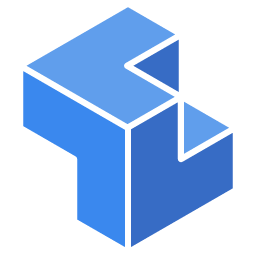
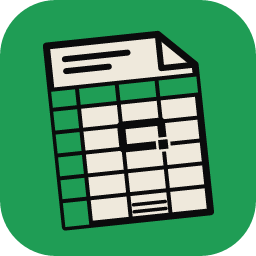

# 🎨 Craft Launcher

Ein moderner grafischer Desktop-Launcher (GTK3) zur Schnellauswahl, Verwaltung und Aktualisierung von Open-Source Kreativ- und Office-Tools unter Linux.

---

## ✨ Features

* **Vollautomatische 1-Klick-Bereitstellung (Zero-Config):** Niemand muss die einzelnen GitHub-Repositories manuell besuchen oder Code herunterladen! Beim ersten Klick auf **`⬇️ Installieren & Starten`** (oder über **`⬇️ Alle bereitstellen`** oben rechts) lädt der Launcher den Quellcode automatisch im Hintergrund von GitHub, entpackt ihn nach `workspace/`, kompiliert die schnelle Release-Version und startet das Programm sofort.
* **🔑 Zentrale KI-Anbindung & Automatischer Modell-Updater (`🔑 KI & Modelle`):** Einmal API-Keys (Google Gemini, OpenAI, Anthropic Claude, xAI Grok, lokales Ollama sowie optional Pexels/Fal.ai) im Launcher hinterlegen – alle KI-fähigen Tools (**DeckCraft**, **SolidCraft**, **ArtCraft**) erhalten die Zugangsdaten beim Start vollautomatisch (inklusive automatischer `userConfig.json`-Synchronisation für DeckCraft). Der Launcher prüft beim Start, alle 30 Minuten sowie per Klick live die Anbieter-APIs und aktualisiert auf Wunsch immer automatisch auf das neueste Flaggschiff-Modell.
* **🧹 Speicherplatz-Turbo (Rust Build-Cache Bereinigung):** Zeigt oben in der Kopfleiste live die aktuelle Größe des `workspace/`-Ordners an (`💾 Workspace: X.X GB`). Nach jedem Kompilieren (oder per Klick auf **`🧹 Speicherplatz`**) werden schwere Rust-Zwischenartefakte (`target/release/deps`, `build`, `.fingerprint`, `incremental`) automatisch bereinigt, während die fertigen Release-Binaries erhalten bleiben – spart **über 28 GB Festplattenplatz**!
* **⭐ Favoriten, „Zuletzt verwendet" & Kompakte Kachel-Ansicht:** Jedes Tool lässt sich per Stern (`⭐` / `☆`) als Favorit oben anheften. Zusätzlich sortiert der Launcher häufig genutzte Tools nach dem letzten Startzeitpunkt nach oben und bietet per Klick auf **`⊞ Kacheln` / `☰ Liste`** eine 3-spaltige Kachel-Übersicht sowie einen eigenen **`⭐ Favoriten`**-Filter.
* **➕ Eigenes GitHub-Tool per URL hinzufügen:** Über den Button **`➕ GitHub-Tool`** oben links kann jede beliebige GitHub-URL eingefügt werden. Der Launcher fragt die GitHub-API ab, lädt automatisch das App-Icon herunter, trägt das Tool in `tools_config.json` ein und kompiliert es im Hintergrund.
* **🟢 Live-Prozess-Anzeige & 1-Klick-Stopp:** Laufende Tools werden in Echtzeit mit einem grünen **`🟢 Aktiv`**-Badge markiert und können direkt aus der Karte heraus über den roten **`⏹️ Stopp`**-Button sauber beendet werden (inklusive Multi-Server-Prozessen wie *DeckCraft*).
* **Original-App-Icons:** Zeigt für jedes der 15 Tools das offizielle hochauflösende App-Logo (`icons/*.png`) an.
* **Schnellsuche & Kategorie-Filter:** Sofortiges Filtern nach Tool-Name, Funktion oder bekannten Alternativen (*Photoshop*, *Lightroom*, *Illustrator*, *Figma*, *InDesign*, *Excel*, *Word*, *AutoCAD*, *SolidWorks*, *Premiere* u.v.m.).
* **Integrierte GitHub-Update-Funktion:** Prüft per Klick auf `🌐 Updates prüfen` gegen die GitHub-API, ob für die Tools neue Commits vorliegen, und aktualisiert sie bei Bedarf vollautomatisch im Hintergrund.
* **Entwickler-Integration:** Direktes Öffnen einzelner Tools im Terminal (`📟`), in VS Code (`💻`) oder im Dateimanager (`📁`).

---

## 📦 Unterstützte Tools (`tools_config.json` – 15 Tools)

| Logo | Tool | Kategorie | Beschreibung / Alternative zu |
| :---: | :--- | :--- | :--- |
|  | **PhotoCraft** | Grafik & Bild | Ebenenbasierte Bildbearbeitung (*Adobe Photoshop*) |
|  | **LightCraft** | Grafik & Bild | Zerstörungsfreie RAW-Fotoentwicklung & Katalog (*Adobe Lightroom*) |
|  | **VectorCraft** | Grafik & Bild | Vektorillustration & SVG (*Adobe Illustrator*) |
|  | **FigCraft** | Grafik & Bild | UI/UX Interface-Design & Prototyping (*Figma*) |
|  | **DesignCraft** | Dokumente & Layout | Desktop Publishing & Layout (*Adobe InDesign*) |
|  | **PdfCraft** | Dokumente & Layout | PDF-Reader, Editor & Organizer (*Adobe Acrobat*) |
|  | **FilmCraft** | Video & Audio | Nichtlinearer Videoschnitt (*Adobe Premiere Pro*) |
|  | **SoundCraft** | Video & Audio | Digitale Audio-Workstation / DAW (*Adobe Audition*) |
|  | **EffectCraft** | Video & Audio | Motion Graphics & VFX Compositing (*Adobe After Effects*) |
|  | **CadCraft** | 3D & CAD | Technisches 2D/3D CAD & Konstruktion (*AutoCAD*) |
|  | **SolidCraft** | 3D & CAD | Parametrisches 3D-CAD & Volumenmodellierung (*SolidWorks / Fusion 360*) |
|  | **ArtCraft** | 3D & CAD | Interaktive KI-Kreativ-IDE & 2D/3D-Compositing |
|  | **GridCraft** | Office | Reaktive Tabellenkalkulation (*Microsoft Excel*) |
|  | **WordCraft** | Office | Textverarbeitung & DOCX (*Microsoft Word*) |
|  | **DeckCraft** | Präsentationen & KI | KI-gestützter Präsentationsgenerator (FastAPI + Next.js) |

---

## 🚀 Schnellstart (für neue Nutzer / Zweit-PC)

```bash
git clone https://github.com/cstorzrenk/CraftLauncher.git
cd CraftLauncher
./setup.sh          # Einmalig System-Pakete & Rust einrichten
./run_launcher.sh   # Launcher starten – Tools laden & bauen sich automatisch per Klick!
```
